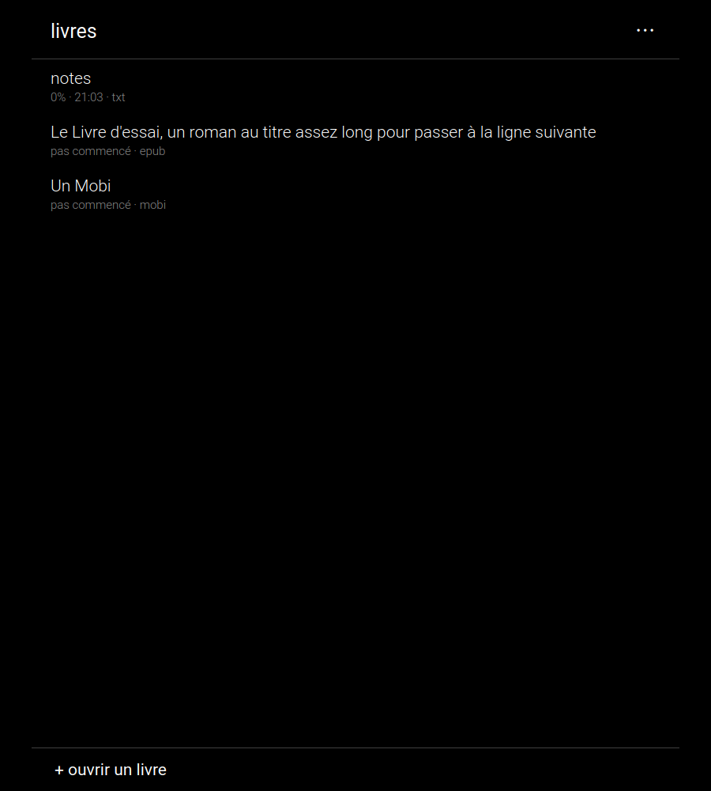
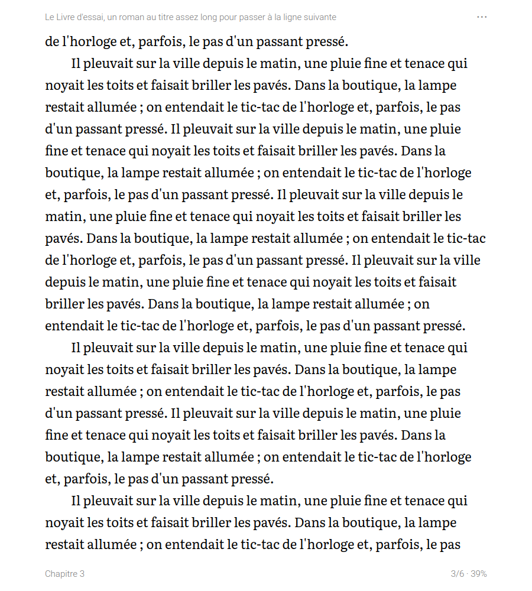

# Reader's Books (desktop)

A shelf as a plain list; books as pages of text cut at whole lines, turned by a click or a key.
EPUB, MOBI, FB2, TXT; the place in each book is kept. No store, no account; the network is used
only if you set up a library on your own drive. The desktop twin of
[Reader's Books for Android](https://github.com/funkypitt/readers-books): the same shelf, the same
reader, the same library, the same wording.

 

## Key points

* The shelf lists title, how far you are, when you last opened it. Click to read; right click for
  chapters or to remove the book.
* The right third of the window turns forward, the left third back, a click in the middle opens
  the book's menu; the arrow keys, the space bar, Page Up/Down and the wheel turn pages too. The
  menu (also a right click, the ⋯ in the corner or the M key): chapters, larger or smaller text
  (+ and − do it too), book text in sans-serif or serif (Literata), back to the shelf, remove.
  Esc goes back.
* Highlights and comments, in the books of the library: drag across a passage, then "highlight"
  or "comment". A highlight is a grey band behind the words, with a line under it when it
  carries a comment; a click on it shows the comment, changes it or removes the highlight. They
  are kept in a file next to the book on the drive (`<book file>.highlights.json`), so every
  device that opens the book has them: each device folds its own into that file, highlight by
  highlight, the one changed last winning. The book's menu exports them as text. Given the
  WebDAV address of the Reader's Notes folder, the app also keeps a note per book there (folder
  `Reader's Books`): the passages between quotation marks, in the order of the book, each
  followed by its comment — Reader's Notes shows it read-only.
* The same file carries the place the book was left at: a book of the library opens where it was
  last read, on whichever device, and the shelf says how far it is. It is exchanged when the app
  starts, when a book is opened, at each highlight, half a minute after the last page turned and
  on leaving the book.
* Add a book from the shelf (Ctrl+O), by dropping the file on the window, or from a file manager
  ("open with"). Books are copied into the app, so the original can move.
* The position is kept per book and survives a change of text size or window. The text sits in a
  column no wider than a comfortable line, whatever the window. The screen stays awake while a
  page is open, until fifteen minutes after the last turn (where the system lets a program ask).
* Pictures in EPUBs are shown in the page, scaled to the text width and never cut; styles and
  footnote links are dropped. MOBI means PalmDoc; no PDF.
* A magazine issue (an EPUB whose contents page carries a section, a title and an author per
  article, as the newspapers pipeline writes them) opens on its contents: sections, titles,
  authors and cover pictures. An article is a chapter; back returns to the contents.
* Optional library: the e-books kept on a drive, at a WebDAV address with a username and an
  application password (kDrive, Nextcloud, any WebDAV server) that the app may read and write,
  listed by folder and then by name or by date, or all in one list by date, name, author or
  last opened (the author is what precedes " - " in the file name, else the folder's name).
  Nothing is downloaded until you click a book. A scan that is stopped, or cut short by closing
  the window, carries on where it was. The account can be exported and imported as the Reader's
  credentials file shared by the other Reader's apps (also `--export-credentials FILE` /
  `--import-credentials FILE`).
* Six languages (English, French, German, Spanish, Portuguese, Russian), white on black or black
  on white, three sizes for the lists.

What the phone has and a computer has no use for is left out: the home-screen widget and the
haptic tick.

## Install

    sudo apt install ./readers-books_1.1.0_all.deb     # Debian, Ubuntu, Pop!_OS
    cd packaging && makepkg -si                         # Arch, Manjaro

Or run it from the source: `python3 readers_books.py` (Python 3.8+, PyQt5, requests).

## Where things are kept

`~/.local/share/readers-books/` holds the books of the shelf, `library.json` (the shelf and the
place in each book) and the list of the drive's books; `~/.config/readers-books/config.json` holds
the settings and the library's account, readable by your account only.

## Tests

    python3 tests/test_books.py
    python3 tests/bench_sync.py

The first runs on books made up by `tests/make_books.py`. The second is the synchronisation in
all its forms — two and three devices sharing one drive, highlights, comments, removals, the
place in the book, logins refused, the note in Reader's Notes — against a real WebDAV server
(`rclone serve webdav`, which it starts itself).

## Crédits / Credits

© 2026 Pierre Gallaz. Développé avec [Claude Code](https://claude.com/claude-code) (Anthropic).
Licence MIT, voir `LICENSE`. Polices : Roboto (Apache 2.0), Literata (SIL OFL 1.1), voir `packaging/fonts`.

© 2026 Pierre Gallaz. Developed with [Claude Code](https://claude.com/claude-code) (Anthropic).
MIT licence, see `LICENSE`. Fonts: Roboto (Apache 2.0), Literata (SIL OFL 1.1), see `packaging/fonts`.
