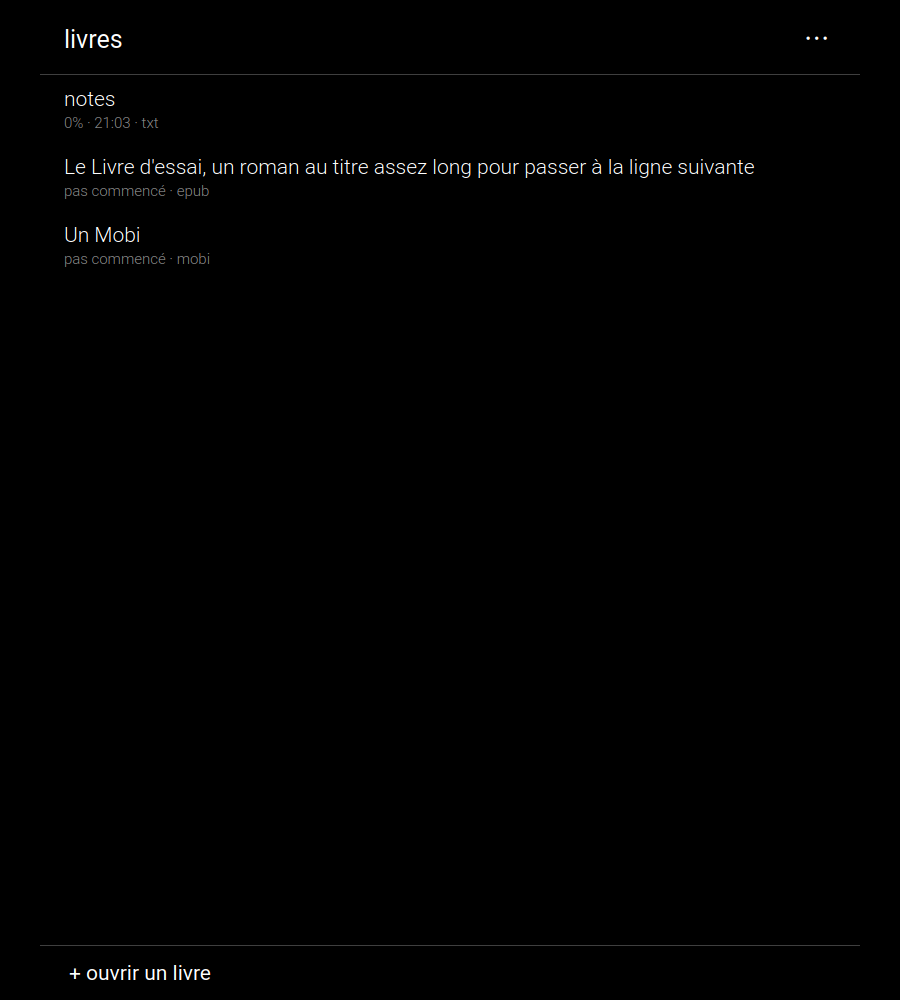
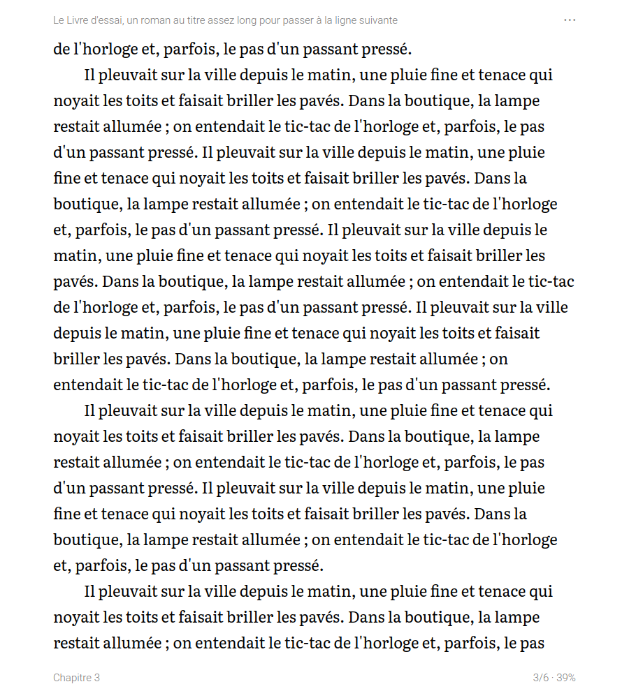

# Reader's Books (desktop)

A shelf as a plain list; books as pages of text cut at whole lines, turned by a click or a key.
EPUB, MOBI, FB2, TXT; the place in each book is kept. No store, no account; the network is used
only if you set up a library on your own drive. The desktop twin of
[Reader's Books for Android](https://github.com/funkypitt/readers-books): the same shelf, the same
reader, the same library, the same wording.

 

## Key points

* The shelf lists title, how far you are, when you last opened it. Click to read; right click for
  chapters or to remove the book. With a library set up, the app opens on the library instead:
  at its top, the book read last (one click and it is at its page), then "on this computer", the
  shelf. Without one, a quiet line under the shelf leads to setting one up.
* The right third of the window turns forward, the left third back, a click in the middle opens
  the book's menu; the arrow keys, the space bar, Page Up/Down and the wheel turn pages too. The
  menu (also a right click, the ⋯ in the corner or the M key): chapters, larger or smaller text
  (+ and − do it too), book text in sans-serif or serif (Literata), back to the shelf, remove.
  Esc goes back.
* Highlights and comments, in every book: drag across a passage, then "highlight"
  or "comment". A highlight is a grey band behind the words, with a line under it when it
  carries a comment; a click on it shows the comment, changes it or removes the highlight. In a
  book of the library they are kept in a file next to the book on the drive
  (`<book file>.highlights.json`), so every device that opens the book has them: each device
  folds its own into that file, highlight by highlight, the one changed last winning. A book
  opened from this computer keeps them here, in a file of the same form; when the same book
  comes from the library later (the same file, or an EPUB with the same identifier and title),
  or is added to it, they are folded into the library's. The book's menu exports them as text. Given the
  WebDAV address of the Reader's Notes folder, the app also keeps a note per book there (folder
  `Reader's Books`): the passages between quotation marks, in the order of the book, each
  followed by its comment — Reader's Notes shows it read-only.
* The same file carries the place the book was left at: a book of the library opens where it was
  last read, on whichever device, and the shelf says how far it is. It is exchanged when the app
  starts, when a book is opened, at each highlight, half a minute after the last page turned and
  on leaving the book.
* A book opened from a file can join the library: "add to the library" in its menu copies it to
  the drive, into the folder you choose (nothing there is written over), and from then on its
  highlights and the page you are at travel like those of any book of the library.
* Add a book from the shelf (Ctrl+O), by dropping the file on the window, or from a file manager
  ("open with"). Books are copied into the app, so the original can move.
* On a Mac (1.20.2), the Finder hands books over too: a double click, Open With, a book dropped
  on the Dock icon — EPUB, MOBI, AZW3, FB2, TXT; the screen stays awake there as well, and the
  app speaks the Mac's language even when opened from the Finder.
* The position is kept per book and survives a change of text size or window. The text sits in a
  column no wider than a comfortable line, whatever the window. The screen stays awake while a
  page is open, until fifteen minutes after the last turn (where the system lets a program ask).
* Pictures in EPUBs are shown in the page, scaled to the text width and never cut; a click in
  the middle of a picture shows it on the whole window (the wheel or + and − zoom around the
  pointer, a drag moves it, 0 fits it again, a click or Esc closes it) — the way to read a table.
  Styles and footnote links are dropped; footnotes are small print. MOBI means PalmDoc.
* A PDF — a paper, an essay, a novel — opened or dropped like a book, is turned into an EPUB, and the EPUB goes on
  the shelf (and, from its menu, in the library — so the phone reads it too); the PDF itself is
  left as it was. The open dialog, the shelf and the progress line say so. `paper2epub.py`
  finds the blocks of every page with [Marker](https://github.com/datalab-to/marker), from the PDF's own text: headings
  make the chapters (by the sections' numbers when the paper numbers them), the text becomes
  paragraphs joined again across pages and columns, a journal's sidebar goes to the title page,
  footnotes close their chapter, short sub- and superscripts are written in Unicode (x², dₖ).
  Displayed equations, figures and tables are cut out of the page as pictures, exactly as
  printed, padded to the width of the paper's column so that their print comes out at about
  the size of the book's text; a line the text layer lost, or mathematics it garbled, is cut out
  too rather than dropped. A scanned PDF (no text on most pages) is read first by
  [Tesseract](https://github.com/tesseract-ocr/tesseract) when it is installed (the .deb
  recommends it with English, French, German, Spanish, Portuguese and Russian): the language is
  the one Tesseract reads three sample pages best in, the pages are read side by side (about
  0.4 s a page, Marker included), and what it read in drawings and frames — unsure words that
  do not look like words and are never read for sure elsewhere in the book — is left out.
  Without Tesseract, a scan becomes its pages as pictures and the shelf says what to install. The
  converter is set up on first use, in a Python environment of its own (`paper-converter` in
  the app's data folder: Marker and the CPU build of torch, about 2 GB with its models; delete
  the folder to take it away); it never runs inside the app, and the model servers Marker
  starts (about 3 GB of memory, meant by Marker to outlive it) are stopped once the PDF is done. A paper takes about ten seconds.
  A book is helped by what the PDF knows besides Marker: its bookmarks give the chapters (the
  upper levels open chapters, the deeper ones are headings inside); without bookmarks, lines
  alone such as « – II – » or « Chapter 3 » open them. A line Marker lost is read from the text
  layer rather than cut out; dialogue Marker took for a list keeps its dashes, a line each; a
  heading that reads as a line of the text (« Il répondit : ») is a paragraph again; the printed
  table of contents goes (the reader has its own), and so do a proof's crop marks. Measured on
  Bel-Ami (472 pages, 80 s) and Lessig's Free Culture (352 pages, 64 s).
  On its own: `<that environment>/bin/python paper2epub.py paper.pdf paper.epub`.
* An issue of **The Economist**, **The New Yorker** or **Le Monde diplomatique** in PDF is recognised by its typefaces and
  made by `magazine2epub.py` instead (pypdfium2 and Pillow only, no Marker, about ten seconds an
  issue): one chapter per article with its section, rubric, title, standfirst and byline, in the
  order of the issue, so the shelf shows it as a magazine with its contents. Each page is read
  the way the eye goes (bands across, then columns; every cut down the page tried, the one whose
  text runs on best kept), articles run on across columns and pages (The Economist's own signs
  are read: ▸ before a piece that goes on from another page, ⏩ after one that jumps, ■ at an end),
  words cut at line ends are mended (the hyphen kept only where the word carries one), small
  capitals, italics and bold kept; photographs, cartoons and charts are cut out of the page with
  their captions; boxes are set apart; poems printed among a piece's pages become pieces of
  their own, a title that is only a drawing is found in the table of contents; advertisements,
  the contents, the masthead and the crossword are left out. Le Monde diplomatique, a newspaper,
  has more: the articles begun on the front page are joined to their end (« Lire la suite page
  13 »), a headline across two facing pages is read as one and the pages under it a page at a
  time, in bands from each such headline; a review's last column running on beside the next
  piece is read before it where the word cut at the column's foot says so; a frame the text is
  set round (a map's) is not a box; the boxed pieces and their
  footnotes follow their article, the short reviews of the books' pages are grouped by field,
  and the issue is dated the first of its month. On its own:
  `<that environment>/bin/python magazine2epub.py issue.pdf issue.epub` (`--which issue.pdf`
  says which magazine it is, if any).
  Papers are for the Linux packages and the source: the Windows and macOS builds have no
  Python of their own to set the converter up with.
* The library's page keeps apart what is a tool and what is books: **search** and **sync now**
  are two framed buttons, with what the sync did under them, and what the library asks for (a
  choice of folders, a scan to carry on) in small print; under a rule, **on the drive** heads the
  books only — news, all books and the folders. A sync lists first the folders the last syncs
  found books in, at once, then the folders on the way to them, then the rest of the drive (where
  new books are only looked for): on a drive of 20 000 folders, the 77 that hold books are up to
  date in seconds.
* **news by periodical** (the news' ⋯ menu, « by periodical » / « every issue »): one line per
  newspaper, magazine, newsletter or channel, the one with the latest issue first; a click lists
  its issues, the newest first, each under its own title. Issues go together by what their file
  names share (« 2026-11-10-letemps.epub »; « 2026-11-09-norwitz-<episode>.epub »), and the
  periodical is named as its issues name it inside (« Le Temps », « Nick Norwitz MD PhD »).
* **news** in the library (there only when the library holds some): the issues of newspapers and
  magazines, and the gatherings of articles (a newsletter's, a channel's summaries), from every
  folder in one list, the newest first by the issue's own date (its dc:date; else the file's
  creation on the drive, else its last change). An issue is told from a book by its contents
  page — a title per article, with its section or its author or alone — or by articles that
  begin with a section and a headline; read on the drive without downloading the book: the end of the EPUB
  (its zip directory), then its package and its nav, a few kilobytes each, three at a time, the
  latest files first; what is found is remembered for each file (`library-kinds.json`) until the
  file changes. Books already on this computer are told by what the reader found. The twin of
  the phone's.
* A magazine issue (an EPUB whose contents page carries a section, a title and an author per
  article, as the newspapers pipeline writes them) opens on its contents the first time:
  sections, titles, authors and larger pictures, in a list that scrolls like the others,
  centred on the article read last; a click opens an article. An article is a chapter; above it, a slim bar leads to the previous article, the
  contents and the next one, and each article reopens where it was left. Opened again, an issue
  goes back to the article it was left at. Several issues of one magazine make one row of the
  shelf, « 24 heures · 3 issues »: a click opens the latest, a right click lists them all. Issues
  belong to the same magazine when their titles agree once the date is taken off (what comes
  before « — Edition du … »).
* Italic and bold show in every book; the text itself, where highlights are counted, is the same
  as without them.
* Books and magazines are set the way their publisher set them, from the book's own style
  sheets: headings in their sizes, centred, right-aligned and justified text, indents and the
  space between paragraphs, quotations and verse in their margins, lists with bullets and
  numbers, tables as grids, small capitals, raised notes, rules, pictures at their own size with
  their captions, large initials, a new page where the book asks for one, the lines of code and
  verse. The font, size, margins and colours stay the reader's; text written over several lines
  of the source reads as one paragraph. Nothing of this changes the text, where highlights are
  counted.
* A folder of the library can be followed (right click on it): it then sits near the top of the
  library with the number of its new books, counted from the last listing of the drive. Nothing
  is downloaded by itself: a click lists that folder again, fetches its new books one after the
  other (the row says how far it is) and opens the new one, or the folder's issues when several
  came or none. When a folder is first followed, its latest day's books are the new ones; a book
  fetched, or removed from the shelf, is not new again.
* Optional library: the e-books kept on a drive, at a WebDAV address with a username and an
  application password (kDrive, Nextcloud, any WebDAV server) that the app may read and write,
  listed by folder — every folder, or the top folders only, each standing for everything inside
  it (the library's menu) — or all in one list; a folder can show the books of its subfolders
  too. Every list has its order: folders by name, latest book or number of books; books by date,
  name, author or last opened (the author is what precedes " - " in the file name, else the
  folder's name); the shelf by last opened, title or last added.
  Nothing is downloaded until you click a book. The library syncs with the "sync now" row near
  its top; what is known stays on the screen while the drive is walked, new books appear, books
  gone from the drive go. A sync that is stopped, or cut short by closing the window, carries on
  where it was with "continue the scan". Once the drive
  has been walked, the library offers to keep only some of its folders (with everything inside
  them): fewer folders, faster syncs — the choice is in the library's menu and in the settings.
  A right click on a folder leaves it out instead, with everything inside it, whatever else is
  chosen: neither shown nor synced, until it is taken back in from the same list.
  The account can be exported and imported as the Reader's credentials file shared by the other
  Reader's apps (also `--export-credentials FILE` / `--import-credentials FILE`).
* The transcripts made in Reader's Podcasts arrive by themselves: it sends each one, as a small
  book, to a `transcriptions` folder at the top of the library (a folder per channel), and that
  folder is looked at again every time the library is opened, whatever folders are chosen — no
  sync to ask for. They are books like the others: read, highlighted, commented, with their note
  in Reader's Notes.
* Six languages (English, French, German, Spanish, Portuguese, Russian), white on black or black
  on white, three sizes for the lists.

What the phone has and a computer has no use for is left out: the home-screen widget and the
haptic tick.

## Install

    sudo apt install ./readers-books_1.6.0_all.deb     # Debian, Ubuntu, Pop!_OS
    cd packaging && makepkg -si                         # Arch, Manjaro

Or run it from the source: `python3 readers_books.py` (Python 3.8+, PyQt5, requests; python3-venv
for the papers in PDF).

**macOS** — download `readers-books_<version>_macos_apple-silicon.dmg` (an M1 or later Mac) or
`readers-books_<version>_macos_intel.dmg` from the
[releases](https://github.com/funkypitt/readers-books-desktop/releases), open it and drag
Reader's Books to Applications. It needs macOS 11 (Big Sur) or later on Apple silicon, 10.13 or
later on Intel. The app has no Apple developer signature, so the first launch is refused: then
open System Settings › Privacy & Security, and under the refusal click **Open Anyway** (macOS 15
and later); on macOS 14 and earlier, right click the app › Open › Open. Once is enough. Or, in
the Terminal:

    xattr -dr com.apple.quarantine "/Applications/Readers Books.app"

The Mac and Windows builds read every book but do not turn PDFs into EPUBs: that converter needs
a Python of its own, which the Linux packages and the source have.

**Windows** — `readers-books_<version>_windows_x64.exe` runs as it is; SmartScreen warns once
(More info › Run anyway).

## Where things are kept

`~/.local/share/readers-books/` holds the books of the shelf, `library.json` (the shelf and the
place in each book) and the list of the drive's books; `~/.config/readers-books/config.json` holds
the settings and the library's account, readable by your account only. On a Mac both are in
`~/Library/Application Support/readers-books/`; on Windows in `%APPDATA%\Readers Books\`.

## Tests

    python3 tests/test_books.py
    python3 tests/bench_sync.py
    python3 tests/canonical.py check SNAPSHOT BOOKS...

The first runs on books made up by `tests/make_books.py`; its last case drives the library page
against a small drive it serves itself (`rclone serve webdav`, skipped without rclone) and
saves its screenshots in `$READERS_BOOKS_SHOTS` when that is set. The second is the
synchronisation in all its forms — two and three devices sharing one drive, highlights,
comments, removals, the place in the book, logins refused, the note in Reader's Notes — against
a real WebDAV server (`rclone serve webdav`, which it starts itself). The third reads books
and compares the text of every chapter with a snapshot taken by an earlier version
(`canonical.py write`): the presentation must never move a highlight; the phone's CanonicalTest
reads the same snapshot.

## Crédits / Credits

© 2026 Pierre Gallaz. Développé avec [Claude Code](https://claude.com/claude-code) (Anthropic).
Licence MIT, voir `LICENSE`. Polices : Roboto (Apache 2.0), Literata (SIL OFL 1.1), voir `packaging/fonts`.

© 2026 Pierre Gallaz. Developed with [Claude Code](https://claude.com/claude-code) (Anthropic).
MIT licence, see `LICENSE`. Fonts: Roboto (Apache 2.0), Literata (SIL OFL 1.1), see `packaging/fonts`.
